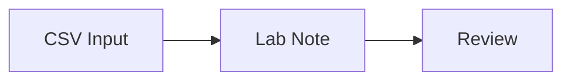

# aira-nexus

aira-nexus is a local AI for Science workspace linking one project chat to notebooks, immutable files and recorded runs. This guide helps local developers check prerequisites and validate an independent backup restore.

Target: the private 0.1.0 development implementation, not a released service.
The Japanese workspace and composed local API have real PostgreSQL/Chromium
tests; final qualification is recorded separately from these development checks.
The feature contracts are in [.sdd/specs](.sdd/specs); the sole implementation
plan is [.sdd/implementation-plan.json](.sdd/implementation-plan.json).

日本語の参照資料: [要件定義書](docs/requirements.md)・[設計書](docs/design.md)。
正式な要件IDと試験対応は `.sdd/specs/` を正とし、電子実験ノートの保存履歴・
差分・復元とローカルGit自動出力の構成・制約も記載しています。

## What the backend preserves

Research records live in PostgreSQL; file versions reference private immutable
blobs by ID and SHA-256. Proposals, explicit confirmations and recorded run
snapshots separate a suggestion from an authorized action. Local advisory
checks report their examined and omitted scope, not scientific validity.

Imported outputs and historical runtime identities are evidence, not permission
to execute code or stop containers. Credentials are local operational state,
not part of a research backup.

## Find and organize projects

The project creation dialog accepts a name and an optional description.
Use the search field below **プロジェクト管理** to filter projects by name or
description. The list is split into **ピン止め済み** and **最近のプロジェクト**;
recent projects are ordered by the last time they were opened, with unopened
projects ordered by creation time. Pins and visit times are stored locally in
the application database and survive browser reloads.

Each project's menu contains **詳細を編集** (name and description),
**ピン留め / ピン留めを解除**, and **アーカイブ**. There is no delete action in
this menu. Archiving still requires confirmation and retains the research
data in read-only form; archived projects can still be pinned or unpinned.

## ELN saved history and local Git

The fixed journal provides editable **Text** and direct **Rendered Markdown**
modes, timestamp insertion, headings 1–3, bold, italic and strikethrough.
Ordinary ipynb/file-view controls and Markdown/history storage remain unchanged.
See the authoring design in [docs/design.md](docs/design.md).

Each project has one dedicated Markdown-only journal in the fixed **Lab Note**
tab immediately after **AI Chat** (Japanese: **実験ノート**).
The explorer's **ipynb** manager remains separate and allows multiple notebooks.
Migration 014 adds a new empty journal without promoting or rewriting an
existing notebook, including one named `Demo Lab Note`. New-project provisioning
is atomic at transaction commit and preserves either project/chat insertion order.
The fixed journal preserves Markdown metadata and saved history, but offers no
code execution. Mode changes never save or rewrite a draft. Complex scientific
blocks retain their source and are edited in Text mode.

Open an ELN and select **保存履歴 / Saved history** to inspect saved source
versions, compare cells with the current saved revision, or explicitly restore
a past version as a new revision. Dirty drafts and archived projects cannot be
restored. Viewing history never runs code or sends research externally.
Restoration keeps the historical YAML; the new server event separately records
the self-declared restorer and source revision.

PostgreSQL is authoritative. Every committed creation, import, save, PATCH,
accepted AI edit and restoration also queues an automatic local bare-Git export.
The history dialog distinguishes pending/exported/error/blocked states and offers
project-wide retry or confirmed rebuild into a new generation. There is no push,
automatic pruning or history-specific retention quota. Monitor disk usage.
Git failure does not undo a successful database save.

Migration registers only the existing current revision, with unknown historical
editor and migration recording time. It does not invent earlier versions.
An unknown crash lock requires an explicit new-generation rebuild; old
repositories are retained. Git is derived and is not included in authoritative
DB-plus-blob backups; independent restoration validates all saved hashes and
current heads, clears derived export state and permits rebuilding Git.

History endpoints are separate from execution `/history`, under
`/api/projects/:projectId/notebooks/:notebookId/versions`.
Editors are self-declared, not authenticated authors. Full-project formal SDD
qualification requires current evidence for all 22 planned tasks and two clean
runs of a frozen validation matrix; individual feature checks are not a substitute.
Markdown uploads and cell saves preserve an existing leading UTF-8 BOM before
the managed YAML header and retain the original body (`TEST-MARKDOWN-004`).

## Prerequisites for local development

Use Linux with a non-root UID/GID, Node.js 24, npm, Docker, Git, and the GitHub
Copilot CLI. Authenticate through the CLI; never paste credentials into a
browser field or a report. A Docker socket grants significant host access:
only run trusted local code and operate exact application-owned resources.

The database image is pinned to
`sha256:3540c0362c809df084ffac0ae69fe794515f9de92692f02178bcdce0ef0302ac`.
The validated runtime image is
`sha256:ca17b3e0cfba612f32a53005f2aaa7cdc5b8fb3bd2c13e86edae7b41de3c148a`.
Images must already exist locally; startup does not implicitly pull them.
`npm run runtime:build` builds the repository runtime, whose resulting digest
must be checked against the configured digest.
Inspect the built image with:

```bash
docker image inspect --format '{{.Id}}' aira-nexus-runtime:0.1
```

A local rebuild may not reproduce the pinned digest. A different digest is
not automatically trusted; do not bypass the image check or overwrite the
configured pin just to clear readiness.

Keep state on an owner-controlled local filesystem. State directories require
mode `0700`; credentials and immutable blobs require `0600`. Parent paths must
not resolve through symlinks. PostgreSQL uses a private Unix socket, not TCP;
the socket path must fit the host's supported length.

## Verify the backend without sending research to an SDK

From the repository root:

```bash
npm ci
npm run typecheck
npm run lint
node --import tsx --test test/diagnostics.test.ts
```

The diagnostics tests create their own PostgreSQL databases, use controlled
authentication responses, and restore into a separate private validation state.
They require Docker and both pinned local images. They do not authenticate on
your behalf, send research prompts, or use another user's containers.
Passing these checks is not the final product gate or publication approval.

## Interpret readiness and failure events

The local readiness facade distinguishes database socket, application-role
privileges, writer lease, CLI, Copilot authentication, Docker and runtime image.
A lost or unknown lease is never ready. Authentication and runtime readiness
are independent of database readiness.
Open **AIRA Nexus の設定** at the bottom of the project pane, then select
**診断を実行** in the **診断** section, or request
`GET http://127.0.0.1:3000/api/readiness` from the same local origin.
There is no standalone readiness CLI. An infrastructure exception during a lease probe is
unknown, while an observed writer-fence rejection is blocked.

Events contain an ID, timestamp, component, status, fixed code and remediation.
They do not include underlying exception messages, credentials, full prompts or
research contents. Use the event code to address the named prerequisite;
do not make an application role a superuser or disable ownership checks.
Readiness proves observed local prerequisites, not that an SDK request or a
future computation will succeed.

## Back up a quiescent database and its referenced blobs

The following commands are the diagnostics implementation interface; its
validation status is recorded by the native task receipt, not by this guide.
Stop the application writer first. Backup refuses an active writer and uses
the same single-writer advisory lock with a consistent read-only database
snapshot. Do not kill unrelated processes or stop source witness containers
to make a backup pass.

Run from the repository root, replacing `.aira` only if you configured another
source state. Choose a new backup destination; it must not overlap source state.

```bash
node --import tsx scripts/backup.ts "$PWD/.aira" "$PWD/aira-backup"
```

The new private directory contains `research.dump`, `manifest.json` and only
referenced immutable `blobs/`. The manifest binds the dump, current schema
and each blob's size/hash. Operational passwords, `credentials.json`, SDK
authentication files and PostgreSQL data-directory files are not copied.

Backups still contain research text, file contents and history, which may be
sensitive. Protect access and choose an appropriate retention location.
This is not encryption, anonymization, publication or an external upload.
Keep an incomplete backup for diagnosis; never treat it as a valid archive.

## Restore into a new independent validation state

Choose a destination that does not exist. Restore never overwrites an existing
directory, merges with another database, or resumes computation automatically.
Use only a trusted archive created by this implementation.

```bash
node --import tsx scripts/restore-validation.ts "$PWD/aira-backup" "$PWD/aira-restored"
```

Restore checks the dump/schema/blob hashes before creating the destination.
It starts a new owned database, applies the current exact migrations, and
restores research data with fresh database credentials and application/control
identities. It validates foreign keys, exact-one project chats and blob hashes.
Unsupported cross-schema restore is rejected rather than guessed.

Unresolved jobs become interrupted with unknown cleanup. Grants expire and
copied confirmations are revoked. Live writer, runtime, container, reservation
and binding rows are not installed as authority. Their original records remain
in the private `restore-audit.json` as inert historical evidence; a source
container recorded as running is not falsely marked physically stopped.

Validate the restored projects, chat links, notebooks, proposals, run history
and file hashes before using the destination. The source database, credentials,
blobs and containers remain unchanged. A failed restore stops only its newly
created, ownership-verified database and retains its separate state for
diagnosis; it does not repair or delete the source.

## Start the local research workspace

From the repository root, after installing dependencies and the pinned images:

```bash
npm run build
npm start -- --initialize
```

Open `http://127.0.0.1:3000`. State defaults to `.aira`; set `AIRA_STATE_DIR`
to another private directory if needed. Omit `--initialize` on subsequent starts.
`PORT` selects another loopback port. For development, the same owned startup
supports `node --import tsx scripts/start.ts --dev` after initialization.
The startup process migrates the owned database and composes Next.js and the
single application writer in one process. Stop it with Ctrl+C; it closes its
owned runtime resources and writer, while leaving research and the owned
database available for backup. Internet-facing deployment is unsupported;
the explicitly configured trusted-LAN proxy below is the only supported
non-loopback entry point.

Create a project to open its single chat. Use **Notebook** to create or import
an ipynb, edit cells and explicitly save before reviewing execution. Select
immutable input versions, then review the exact code, language, sharing,
input hashes and kernel identity. Approval executes only that bound request;
refusal does not execute. Changes or stale revisions require another review.

The fixed **AI Chat** and **実験ノート / Lab Note** tabs are always the first
two tabs. Open notebooks and immutable file versions from the
explorer as individual, movable and closable tabs. Notebook drafts survive tab
switches; closing a dirty notebook or leaving its project requires confirmation.
Pending notebook mutations prevent closing their originating tab or leaving or
archiving the project.
The separate notebook-manager heading is **ipynb** in both languages.
Notebook tabs retain their saved research names;
changing language does not rename notebooks, files or research contents.

Each project has one independent Markdown journal. Multiple ordinary ipynb
notebooks remain separately creatable/importable, movable and closable.
Existing notebooks are not promoted, merged or rewritten. Migration 014 adds
an empty dedicated journal; rich authoring requires no further migration.
Functional validation passed all 148 application tests; whole-project formal
qualification remains incomplete.

AI changes show their before/after values and never execute automatically.
Chat sends show the outbound payload, including bounded prior history and
only explicitly selected file/result text. **ファイル** supports uploads,
safe previews, downloads and Unicode-position excerpt selection.
Scientific rendering is always enabled for chat responses.
Markdown cells and file previews default to rendered display.
Use **原文を表示** / **Show source** to inspect literal Markdown and
**レンダリングを表示** / **Show rendered** to restore its formatted preview.
The choice is kept per open file tab, not applied to AI Chat or Lab Note.
Ordinary ipynb Markdown cells have their own **原文を表示**, **レンダリングを表示**
and **編集** / **Edit** buttons. Source mode is read-only; Edit reveals the
source field, and **Notebook を保存** persists the draft. New Markdown cells
start in Edit mode. Archived cells allow both read views but not editing.
The fixed journal instead uses **Text表記 / Text** and
**Markdownレンダリング表記 / Rendered Markdown**. Both are directly editable
while active and idle; timestamps target the last focused cell and selection.
Rendered mode also offers `#`, `##`, `###`, bold, italic and strikethrough.
Neither switching modes nor viewing creates a saved version. Actual rich edits
may normalize equivalent Markdown; untouched source, BOM and YAML remain exact.
Rich projection is bounded to 64 KiB UTF-8 and 100 complex previews per cell.
Invalid or oversized rich content remains recoverable in Text mode. HTML-only
or oversized paste is rejected explicitly; archived/busy content is not editable.
HTML files remain attachment-only.
SVG file tabs and Markdown embeds use the controlled image path below.
Imported and stale results, lost kernel state and omitted content are labelled;
historical HTML/MIME stays inert. Archived projects remain read-only.

### Markdown dates and editor history

Set **編集者名** / **Editor name** in bottom-left **AIRA Nexus の設定** and
select **編集者名を保存** / **Save editor name**. The trimmed name (1-80
characters, no controls) is stored for that browser; the default is `local`.
It is a self-declared display name, not a login or verified identity.

Markdown uploads through the workspace and explicit Lab Note Markdown saves
embed YAML front matter containing `aira.created_at`, `aira.updated_at`,
`aira.editor_identity: self-declared` and an `aira.editor_history` list of
`edited_at` / `editor` entries. Changed cells retain creation time and prior
editors; saving unchanged tracked Markdown does not add another history entry.
Other YAML fields and body content are retained. The complete header is visible
in source/download/export, but omitted from rendered Markdown.

Times use the writing browser's UTC clock. Legacy content starts tracking on
its first workspace upload/save; earlier dates/editors are not reconstructed.
This editable YAML is not a tamper-proof audit log. Existing immutable versions,
original local files, raw API transfers and imported records are not silently
rewritten. Files with existing valid metadata retain their self-declared history
when uploaded again. Front matter is limited to 64 KiB; the existing 64 KiB
Notebook source limit includes it. Invalid, aliased or over-budget YAML fails
explicitly instead of dropping history. File preparation reads a bounded prefix
and reuses original body bytes, including multibyte UTF-8 boundaries.

### Embed diagrams and project images in Markdown

Use a Mermaid fence for an inert local diagram:

````markdown

````

The diagram includes **図のソース** / **Diagram source** to inspect its original
fence. Rendering is limited to 10 diagrams per view, 8 KiB UTF-8 source and
1 MiB generated SVG per diagram, with a 100-edge flowchart limit. Initialization
directives, frontmatter, click interactions, URLs, HTML labels and image/icon
embeds are blocked. A blocked or failed diagram keeps its escaped source and
shows an explicit error. Generated SVG is shown only as a Blob-backed image,
not active SVG inside the research content. These client-side limits are not
an interruptible CPU timeout or OS sandbox.

Upload an image to the same project, then use its immutable file UUID:

```markdown

```

Replace the example UUID with the actual uploaded version ID. PNG/JPEG inputs
are signature-checked and re-encoded to PNG. Static SVG is validated and
rasterized to PNG for Markdown embeds and SVG file tabs; original SVG bytes remain
unchanged and downloadable. The shared route independently checks project ownership.
External/data/file images and embeds without project context are not loaded.
Image failures are shown explicitly; there is no automatic AI send or execution.

Static SVG supports bounded shapes, paths, text, gradients and clipping, not
scripts, HTML, external references, CSS/style attributes, image/use elements
or animation. SVG source is limited to 256 KiB and 2000 elements; decoded images
must fit 8192 pixels per dimension and 32 million pixels, with a two-second SVG
rasterization timeout and a 10 MiB PNG output limit. PNG/JPEG source must also
fit 10 MiB. SVG file tabs display only the converted PNG, never active SVG markup.

Run the browser checks against the production build without live research sends:

```bash
npm run build
npm run test:e2e
```

These checks use real PostgreSQL, Chromium and the runtime image, with an
explicitly injected controlled Copilot transport. They do not prove a live
Copilot inference succeeds. The math worker runs from the repository's
`src/server/math-worker.ts`, so keep the repository and dependencies available;
this is not a self-contained standalone deployment package.

## Access the workspace through a dedicated trusted-LAN Nginx

This opt-in mode keeps the application on loopback and exposes only a dedicated
Nginx listener. It has **no login or TLS**: reachable permitted clients share
the local owner's data and confirmation authority. A home firewall and the
proxy's private-address ACL are not authentication or encryption; other local
OS users can still access the application directly.

The pinned prerequisite targets Ubuntu amd64 with `dpkg-deb` and the package's
runtime libraries already available. Installation verifies the approved archive
SHA256 and extracts it privately; it never installs OS packages, runs package
hooks or changes system Nginx, port 80/443 services, firewall or router rules.

Install the prerequisite once:

```bash
npm run proxy:install
```

After stopping only the previous owned Web process, start the already initialized
application in one terminal (do not repeat `--initialize`):

```bash
AIRA_PUBLIC_ORIGIN=http://192.168.11.10:3000 PORT=3000 npm start
```

In another terminal, start the dedicated proxy:

```bash
AIRA_PUBLIC_ORIGIN=http://192.168.11.10:3000 PORT=3000 npm run proxy:start
```

Open `http://192.168.11.10:3000` from a trusted LAN device. Replace the example
address only with an RFC1918 IPv4 actually assigned to this host, and choose an
explicit public port from 1024 through 65535. Both processes must use the same
public origin and actual nonzero upstream `PORT`; application port 0 remains
available for local-only tests but cannot be used as a proxy upstream.

State remains in `.aira`. Nginx binary, configuration, PID, owner lock,
temporary files and bounded shutdown log are separate in private `.aira-proxy`
(`AIRA_PROXY_DIR` overrides that path). Stop each owned terminal process with
Ctrl+C; stop the proxy before the application. Do not use global service or
process-name commands. Existing owner locks, even stale ones, refuse startup:
manual recovery requires proving the former owner and its workers are gone;
PID-file signalling and automatic stale-lock recovery are unsupported.

The proxy preserves Host/Origin, strips forwarded authority, streams requests
and SSE responses, and permits up to 100 MiB at ingress; application-specific
12 MiB JSON and 100 MiB upload guards still apply. It refuses to listen until
the configured loopback app accepts the public Host/Origin. Same-host HTTP
success does not establish that another device can cross host/router firewalls.
The canonical policy is in [trusted-lan](.sdd/specs/trusted-lan.md) and
[projects](.sdd/specs/projects.md).

## Unsupported operations and evidence limits

Research checks use bounded syntax and captured metadata. Missing records,
unsupported Markdown locations, imported evidence and unavailable environment
fields remain explicitly unverified. Checks do not reproduce results, establish
causality or certify scientific correctness.

The twelve research extensions remain deferred in the approved specification.
Do not activate them, publish a release or destroy retained state based on a
plan check, task receipt or this README. There is no automatic backup schedule,
cross-version migration, public multi-user deployment or token-management UI.
